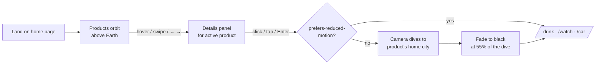
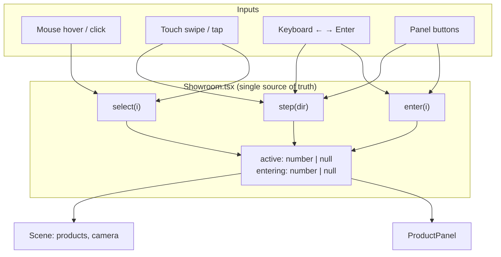

# SHOWROOM by Blue: a 3D product showroom in orbit

> โชว์รูมสินค้า 3 มิติลอยอยู่เหนือโลก ชี้ดูรายละเอียด กดแล้วกล้องดิ่งลงสู่เมืองบ้านเกิดของสินค้า

**Concept project. The products aren't real.** It's a frontend and creative-coding piece built with
Next.js 16, TypeScript, React Three Fiber and a hand-written GLSL shader.

The home page is a showroom floating in space above the Earth. Three products orbit in front of the planet.
Hover one (or swipe to it on a phone) to see its details. Click it and the camera **dives into the Earth
toward the product's home city** (Los Angeles, Geneva, Tokyo), then lands on that product's page.

---

## What this project shows

| Skill | Where it shows up |
|---|---|
| **3D / WebGL** | Custom Earth shader: day/night blend from the sun direction, city lights, moving clouds, ocean glint, fresnel atmosphere (`components/three/Earth.tsx`) |
| **Math for graphics** | Lat/lon → 3D vector, rotating the globe so a city faces the camera, an eased camera path into the surface (`Scene.tsx`, `Earth.tsx`) |
| **React architecture** | Server-rendered text + a client-only 3D island; one state owner (`Showroom`) feeds the scene and the panel |
| **Performance** | three.js split into its own bundle (`dynamic(..., { ssr: false })`), so text paints first; the target page is prefetched during the dive |
| **Responsive + accessible** | Hover on desktop, a swipe carousel on phones, arrow keys + Enter, `prefers-reduced-motion` skips the animation, real `<a>` links for SEO and screen readers |
| **Clean config** | All product data in one file, so changing it never means touching 3D code |

---

## How I thought it through

### 1. Starting from the experience

I started from one question: *how do you make picking a product feel like a journey?*
The answer was a globe. Each product gets a "home city", and choosing it means **travelling there**.
That one idea set the rest of the design:



### 2. One state owner, many inputs

Mouse, touch and keyboard all do the same three things: **pick** a product, **step** to the next or
previous one, and **enter** it. Instead of giving each input its own logic, every input calls the same
three functions in `Showroom.tsx`:



Rules I wrote into that state:

- **Desktop:** nothing is active until you point at something (`active = null`).
- **Phone:** there's no hover, so there's always a product in the middle (`active ?? 0`). Tapping a side
  product slides it to the middle first, and tapping the middle one enters it.
- **While diving** (`entering !== null`) every input is ignored, so a double click can't start two
  navigations.
- **Coming back:** Next.js keeps the old page hidden (React Activity) rather than unmounting it, so a
  cleanup in `useLayoutEffect` resets the dive. Otherwise "Back" lands on a black screen.

### 3. The math of the dive

The hard part is making the camera hit the right city on a sphere that's also rotating:

1. **Rotate the globe** so the city faces the camera: `facingRotation(lat, lon, azimuth)` turns the
   Earth on its Y axis until the city's longitude lines up with the camera's angle.
2. **Find the surface point:** since the city now faces the camera, its direction from the Earth's centre
   is just *(the city's latitude, the camera's azimuth)*:
   `dir = (cos lat · sin az, sin lat, cos lat · cos az)` and `surface = center + dir · R`.
3. **Fly there** with `easeInOutCubic` (slow start, fast middle, soft landing). The camera *looks* at the
   city sooner than it arrives (`e × 1.5`), and the FOV widens by 12° to give a sense of speed.
4. **Time it once:** `DIVE_SECONDS` lives in `lib/dive.ts`, a file with no three.js imports. The camera,
   the fade-to-black and the page change all read that one number, so they can't drift apart, and the
   main bundle doesn't pull in three.js.

### 4. The Earth shader, one pixel at a time

```
sun      = dot(normal, sunDir)              // >0 day side, <0 night side
dayMix   = smoothstep(-0.18, 0.28, sun)     // soft terminator line
water    = (blue − red) of day texture      // oceans are bluer than land
glint    = specular(sun, view)^70 · water   // sun reflects only on water
night    = city lights · (1 − clouds)       // clouds hide the lights
colour   = mix(night, day, dayMix) + fresnel atmosphere at the rim
```

I didn't use a separate water mask. Oceans in the NASA image are bluer than they are red, so
`day.b − day.r` is enough to find the water.

### 5. Trade-offs I chose

| Decision | Why |
|---|---|
| Code-built placeholder models | The real `.glb` models come later; `FloatingProduct` already resizes and centres *any* model to the same size, so swapping them in needs no layout change |
| No GSAP / Zustand yet | A few `useState`s and `THREE.MathUtils.damp` covered it. I add libraries when a step needs them |
| Product data as plain objects | `config/products.ts` has no 3D code in it, so it can move to a database (Supabase) for the shop phase |
| Fade to black, then route | Covers the page swap so the dive and the new page feel like one movement |

---

## Run it

```bash
npm install
npm run dev        # http://localhost:3000
npm run build      # production build
npm run lint
```

Controls: hover / click (desktop), swipe / tap (phone), ← → and Enter (keyboard).

## Project structure

| Path | What it does |
|---|---|
| `app/page.tsx` | Home page: header and headline (server-rendered) + `<Showroom />` |
| `app/drink`, `app/watch`, `app/car` | One route per product (placeholder pages for now) |
| `components/Showroom.tsx` | Interactive state: active product, keyboard, swipe, the dive |
| `components/ProductPanel.tsx` | Details panel at the bottom of the screen |
| `components/three/Scene.tsx` | Canvas, lights, stars, product layout, camera rig (parallax + dive) |
| `components/three/Earth.tsx` | Earth with a custom shader: day/night, city lights, clouds, atmosphere |
| `components/three/FloatingProduct.tsx` | One floating product: size/centre normalisation, hover, label |
| `components/three/placeholders.tsx` | Code-built stand-in models |
| `config/products.ts` | Product data: name, tagline, accent colour, specs, home city |
| `lib/dive.ts`, `lib/format.ts` | Dive duration (shared by scene and page), coordinate formatting |

Full plan and milestones (Thai): [PLAN.md](./PLAN.md). I built it in 14 small, reviewable steps; `git log`
reads as the build diary.

## Roadmap

- [ ] Real `.glb` models (`public/models/`, Y up, front facing +Z, ≤ 10 MB)
- [ ] Product pages: scroll story (drink), live 3D configurator (watch), turntable with colour picker (car)
- [ ] Deploy to Vercel + mobile performance pass (adaptive DPR, fewer stars on low-end GPUs)
- [ ] Shop phase: cart + Stripe test mode, Supabase auth/admin

## Credits

Earth imagery: NASA Earth Observatory (Blue Marble, Black Marble), public domain. See `public/textures/CREDITS.md`.
The car page is a fan concept and isn't affiliated with or endorsed by Nissan.
